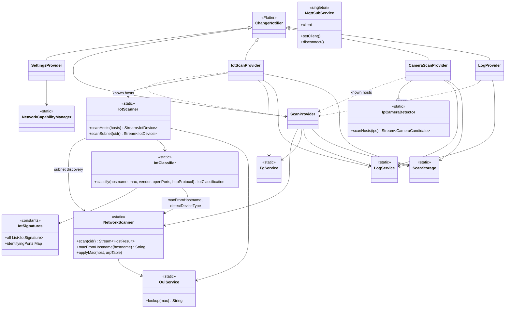
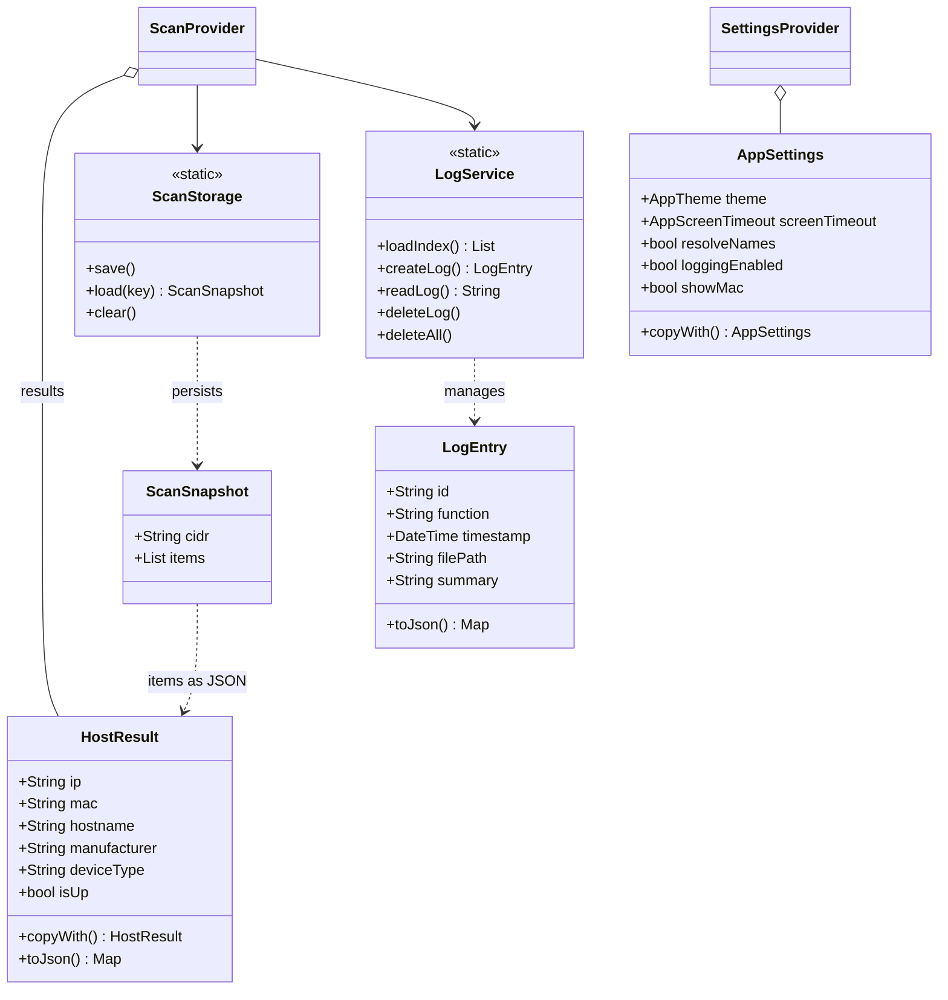
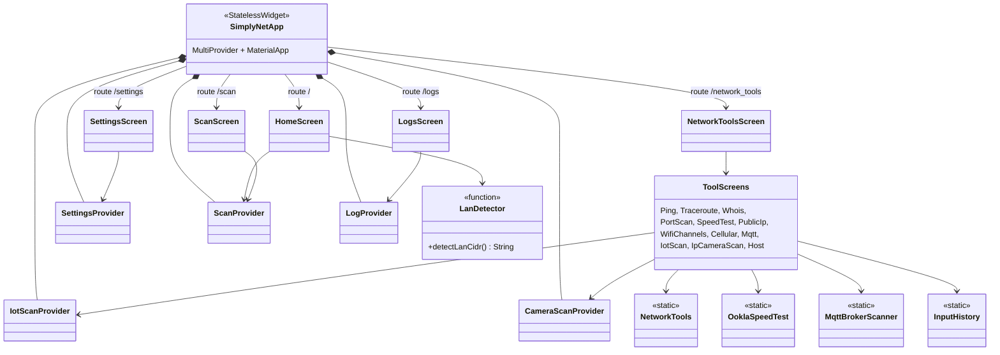
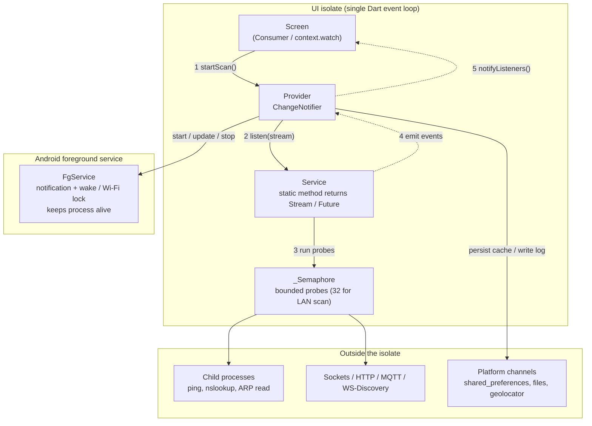
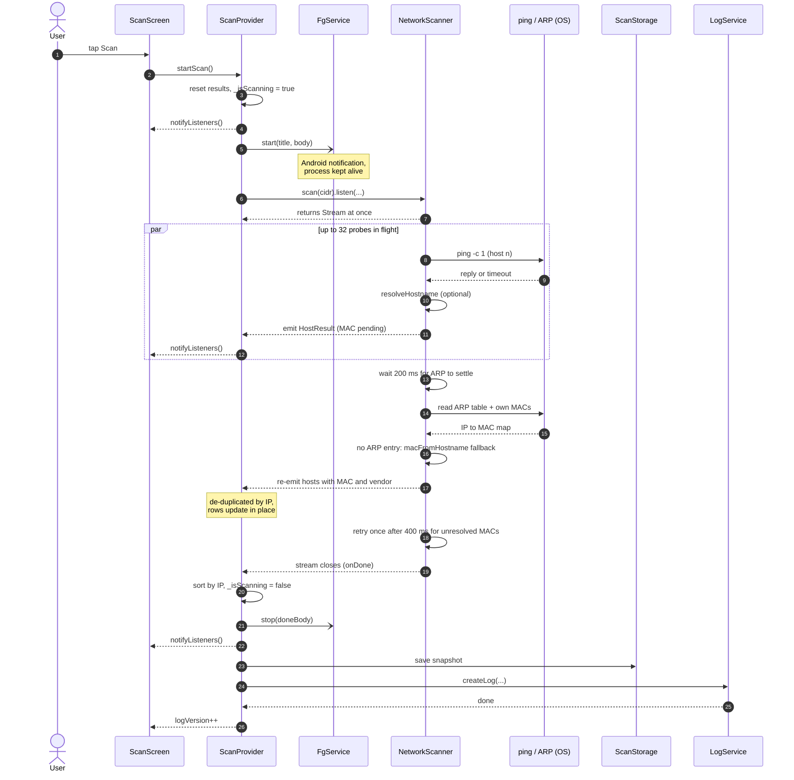
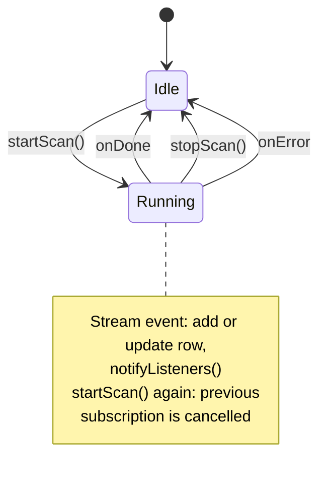

# SimplyNet Architecture

## App architecture

SimplyNet is a cross-platform (Android-first) Flutter app for local network
scanning and diagnostics. It is a single Dart package (`simply_net`) with a
**layer-first** structure under `lib/`, using `provider` (`ChangeNotifier`)
for state management.


### Layers

| Layer | Path | Responsibility |
|-------|------|----------------|
| Entry / composition | `lib/main.dart` | Initializes `OuiService`, builds `MultiProvider`, `MaterialApp`, theme, named routes, `RouteObserver`. |
| Presentation: screens | `lib/screens/` | One screen per feature (scan, ping, traceroute, whois, port scan, speed test, MQTT, IoT, IP camera, Wi-Fi channels, cellular, public IP, logs, settings, about). |
| Presentation: widgets | `lib/widgets/` | Reusable UI: `HistoryField`, `PulsingIcon`, `DiagOutputPanel`, `PingGraphWidget`. |
| State | `lib/providers/` | `ChangeNotifier` controllers that own scan state, call services, persist caches, and notify the UI. |
| Services | `lib/services/` | Network/OS/IO logic: scanners, detectors, diagnostic tools, storage, logging, foreground service. Mostly static-method classes, no Flutter UI. |
| Models | `lib/models/` | Plain data classes: `HostResult`, `LogEntry`, `AppSettings` and enums. |
| Constants / utils | `lib/constants/`, `lib/utils/` | Port lists, log sharing, support links. |
| Localization | `lib/l10n/`, `assets/help/<lang>/` | Generated `AppLocalizations` (16 languages, from ARB via `l10n.yaml`) and localized markdown help pages. |

### Dependency rules

Dependencies point downward only:

```
screens / widgets  ->  providers  ->  services  ->  models / constants
        \________________________________/
          (screens may also call services directly for
           one-shot diagnostics: ping, whois, traceroute, ...)
```

- Services never import providers or screens.
- Providers never import screens.
- `main.dart` is the only place that constructs providers.

### State management

`MultiProvider` at the app root registers:

- `SettingsProvider` — theme, locale, screen timeout, logging/MAC toggles;
  persisted with `shared_preferences`. `MaterialApp` rebuilds through a
  `Consumer<SettingsProvider>`.
- `ScanProvider` — host discovery for a CIDR; sorting, results cache,
  scan log buffer.
- `IotScanProvider`, `CameraScanProvider` — follow-up scans of the hosts
  found by `ScanProvider`; each caches results and writes a log.
- `LogProvider` — a `ChangeNotifierProxyProvider<ScanProvider, LogProvider>`
  that listens to `ScanProvider` and refreshes the log list.

`MqttSubService` (in `mqtt_provider.dart`) is a plain singleton, not a
`ChangeNotifier`. It holds the MQTT client and subscription so the connection
survives screen navigation.

Long-running scans expose results as `Stream`s from services; providers
subscribe, accumulate, and call `notifyListeners()`. Diagnostic tools
(`NetworkTools`) stream text lines to `DiagOutputPanel`.

### Key flows

**LAN scan.** `HomeScreen` detects the CIDR via `detectLanCidr()`, then
`ScanProvider.startScan()` starts `FgService` (foreground notification),
consumes `NetworkScanner.scan(cidr)` (ARP table, ping probes, hostname
resolution, vendor lookup through `OuiService`), updates the host list, saves
a `ScanSnapshot` via `ScanStorage`, and writes a log via `LogService`. When
the ARP table has no MAC for a host (Android 10+ hides it),
`NetworkScanner.applyMac` falls back to a MAC published as the leftmost
hostname label (`macFromHostname`, 12 hex characters, e.g.
`a4cf12aabbcc.lan`); an ARP MAC always wins.

**IoT scan.** `IotScanProvider` receives the full `HostResult`s (hostname,
MAC, manufacturer) of the last LAN scan and runs `IotScanner.scanHosts`. With
no fresh scan, `IotScanner.scanSubnet` takes hostnames and MACs from a
`NetworkScanner.scan` ping sweep but TCP-probes *every* address of the subnet
(`subnetTargets`), because many IoT devices ignore ping. Hosts whose MAC is
still unknown get it from the ARP table read once during the IoT scan, else
from a MAC published as the hostname (`effectiveMac`). Vendors come from
`OuiService` (`assets/oui.json` plus a few IoT prefixes missing from the IEEE
registry); the IoT scanner has no OUI table of its own.

Per host, `scanPorts` probes `NetworkPorts.iotPortNames` with a global cap on
simultaneous connects (96), a 1.5 s timeout and one retry of timed-out ports.
Addresses no ping answered must first reply on a short liveness gate (ports
80, 8123, 1883, 6668). Each port ends as open, closed (refused), timeout or
unreachable (`PortProbeOutcome`). The scanner then fingerprints the web page
of every open web port, tries the TP-Link Kasa protocol on 9999, and hands
everything to `IotClassifier`. The classifier scores independent evidence —
hostname signature (`IotSignatures`), MAC in the hostname, IoT vendor, open
ports, HTTP fingerprint, Matter TCP port — into a label and an
`IotConfidence` (one signal `possible`, two `probable`, three or a conclusive
one `definite`). No single signal is required, so a plug with no open port is
still found by its hostname or MAC. Reachable hosts with no evidence are
written to the scan log (`onSkipped`) with their port outcome counts, so a
missed device can be diagnosed.

**Camera scan.** `CameraScanProvider` takes the known host IPs from the last
scan and runs `IpCameraDetector.scanHosts`, with a subnet-wide fallback.

**Logs.** `LogService` stores log files and an index under the app documents
directory; `LogProvider` exposes them to `LogsScreen`, which can share them
via `log_sharing.dart` (`share_plus`).

**Settings.** `SettingsProvider` persists `AppSettings` values and applies
the screen-timeout policy; `NetworkCapabilityManager` reports platform
limits (e.g. MAC resolution blocked).

### Persistence and platform integration

| Concern | Mechanism |
|---------|-----------|
| Settings, scan caches, input history | `shared_preferences` (`ScanStorage`, `InputHistory`, `SettingsProvider`) |
| Log files | `path_provider` + files (`LogService`) |
| OUI vendor database | bundled `assets/oui.json` (`OuiService`) — the only OUI source in the app |
| Background scanning | `flutter_foreground_task` (`FgService`) |
| Connectivity info | `network_info_plus`, `geolocator`, `permission_handler`, `device_info_plus` |
| MQTT | `mqtt_client` |
| HTTP (public IP, speed test, whois) | `http` |
| Sharing / links | `share_plus`, `url_launcher` |

### Testing

Unit tests live in `test/` and mirror the services, providers, and models
(for example `scan_provider_test.dart`, `network_scanner_*_test.dart`,
`log_service_test.dart`).

## UML diagram

The class model is split into three focused diagrams (Mermaid) so that
edges stay short and do not cross unrelated classes. Private widget classes
and generated localization classes are omitted.

### 1. Providers and services



### 2. Data models and persistence



### 3. Screens and app composition



## Asynchronous calls and background tasks

### Concurrency model

All app Dart code runs on a **single UI isolate**; there are no custom
isolates (`Isolate.run` / `compute`). "Background" work is cooperative:
`async`/`await`, `Stream`s, and `Future.wait` interleave on the one event loop,
while the heavy lifting happens outside Dart: child OS processes (`ping`,
`nslookup`, ARP reads), sockets (`dart:io`), and plugin platform channels.
A semaphore caps in-flight probes so the event loop and the phone stay
responsive. On Android, a **foreground service** keeps the process alive when
the app is backgrounded; it carries no scan logic itself, only a notification.



### Building blocks

| Mechanism | Where | Purpose |
|-----------|-------|---------|
| `Stream<T>` from a service | `NetworkScanner.scan`, `IotScanner.scanHosts`, `IpCameraDetector.scanHosts`, `NetworkTools.ping` and others | Deliver results progressively so the list fills while the scan runs. |
| `StreamController` + `unawaited` runner | `NetworkScanner.scan` | Bridges a long `async` routine to a `Stream`; errors are forwarded with `addError`, then the controller closes. |
| `StreamSubscription` held by the provider | `ScanProvider`, `IotScanProvider`, `CameraScanProvider`, `PingScreen` | The handle used to stop a task: `cancel()` ends it, keeping partial results. |
| `_Semaphore.run` + `Future.wait` | `NetworkScanner`, `IotScanner`, `NetworkTools` | Run every probe "concurrently" but with bounded fan-out. |
| Chunked `Future.wait` | `MqttBrokerScanner` | Probes hosts in batches of 64, awaiting each batch before the next. |
| `Completer` | `NetworkScanner._isAlive` | Resolves as soon as one probe succeeds, or `false` after all fail. |
| `Timer.periodic` | `IotScanProvider` | Animates an approximate progress bar during the host-discovery phase of a full subnet scan, which gives no per-host progress. |
| Memoised `Future` | `loadCache()` in each scan provider | The first call starts loading, later callers `await` the same future. |
| `ValueNotifier` | `ScanProvider.logVersion` | Tells the UI a new log file exists once the async write finishes. |
| `ChangeNotifierProxyProvider` | `LogProvider` | Reacts to `ScanProvider` changes without screens wiring them together. |

### LAN scan sequence

The `ScanProvider.startScan` flow, which the IoT and camera providers
follow in the same shape. The foreground-service calls are fire-and-forget
(`Future`s that are not awaited by `startScan`).



### Task lifecycle

Every long-running task (host scan, IoT scan, camera scan, ping, traceroute,
port scan) moves through the same states. Cancelling is a normal exit, not an
error: the partial list is sorted, cached, and shown.



| Transition | Trigger | What happens |
|------------|---------|--------------|
| Idle to Running | `startScan()` | Reset results, subscribe to the stream, `FgService.start`. |
| Running to Idle (completed) | stream `onDone` | Sort by IP, `FgService.stop`, save cache, write log. |
| Running to Idle (stopped) | `stopScan()` | `subscription.cancel()`, keep and cache the partial results. |
| Running to Idle (failed) | stream `onError` | Log the error, `FgService.stop`. |

### Error handling in background tasks

- Service streams forward failures through `addError`; the provider's
  `onError` clears the running flag, stops the foreground service, and
  records the error in the scan log (`scan_error`).
- Failures while writing the log or cache are caught around the `await` so a
  storage problem never leaves the UI stuck in the "scanning" state.
- A corrupt cache raises `FormatException`, which `loadCache()` handles by
  clearing the stored snapshot.
- `IotScanProvider` ignores a second `startScan()` while one is running;
  `ScanProvider` instead cancels the old subscription and starts over.

### Known limitations

- **Single isolate.** CPU-heavy work (e.g. parsing a large OUI table or large
  responses) shares the event loop with rendering. Moving it to
  `Isolate.run` would be the next step if frame drops appear.
- **Android only.** `FgService` returns immediately on other platforms, so
  scans there stop when the OS suspends the app.
- **Fire-and-forget calls.** `FgService.start/stop` and `_saveCache()` are
  called without `await` in non-async methods (`startScan`, `stopScan`). This
  also conflicts with the `discarded_futures` rule in `AGENTS.md`.
  (The current `analysis_options.yaml` only includes `flutter_lints`, so the
  analyzer does not flag it yet.)
